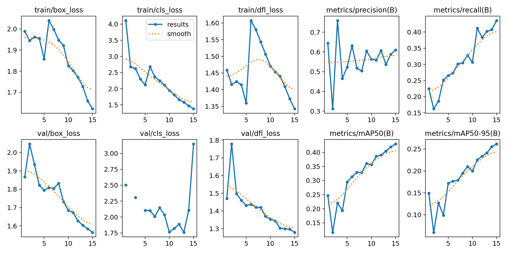
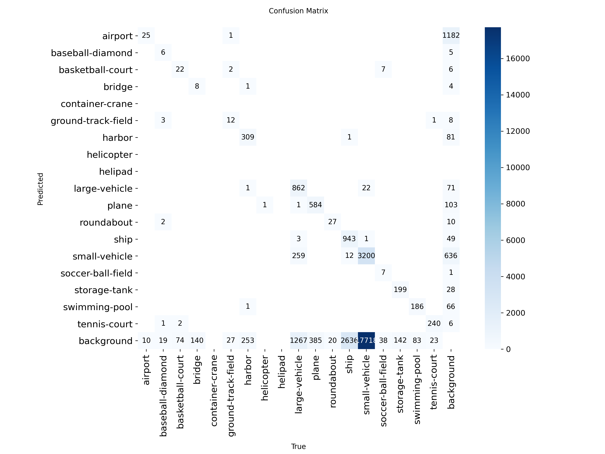

# Advancing Satellite Imagery Object Detection via YOLOv8 and Tiled Inference

## 📋 Overview

Object detection in high-resolution aerial and satellite imagery plays a crucial role in urban planning, geospatial analysis, infrastructure monitoring, and remote sensing. However, detecting small, densely packed, and overlapping objects remains challenging when large images are resized to fit conventional object detection models.

This project implements an advanced object detection framework using **YOLOv8 (Ultralytics)** and **tiled inference** to detect multiple object categories in high-resolution aerial imagery from the **DOTA (Dataset for Object Detection in Aerial Images)** benchmark.

The framework divides large images into smaller, overlapping tiles, performs object detection on individual tiles, and maps the predictions back to the original image coordinates. A post-processing stage combines detections and suppresses duplicate bounding boxes across overlapping regions.

The project also evaluates model performance using training and validation loss curves, precision, recall, mean Average Precision (mAP), and a multi-class confusion matrix.

### Key Features

- **YOLOv8-Based Object Detection:** Uses a deep learning object detection architecture for aerial image analysis.
- **High-Resolution Image Tiling:** Processes large images in smaller sections to preserve fine-grained object details.
- **Overlapping Tile Processing:** Helps reduce missed detections near tile boundaries.
- **Multi-Class Detection:** Supports 15 aerial object categories from the DOTA benchmark.
- **Duplicate Detection Removal:** Applies Non-Maximum Suppression (NMS) to reduce overlapping predictions.
- **Training Performance Monitoring:** Visualizes training and validation losses, precision, recall, and mAP.
- **Confusion Matrix Analysis:** Evaluates classification and detection behavior across object categories.
- **GPU-Accelerated Training and Inference:** Supports NVIDIA GPU acceleration through the PyTorch ecosystem.

---

## 🗂️ Project Structure

```text
├── dataset/
│   └── dota/
│       # DOTA aerial imagery and annotations, download from kaggle
│
├── satellite_yolov8_tiling.ipynb
│       # Tiling, training, inference, and evaluation
│
├── assets/
│   ├── training_metrics.png
│   │   # Training/validation losses and detection metrics
│   └── confusion_matrix.png
│       # Multi-class confusion matrix
│
├── requirements.txt
│   # Project dependencies
│
└── README.md
    # Project documentation
```

---

## 🛠️ Dataset Information

### DOTA Benchmark

The project uses the **DOTA (Dataset for Object Detection in Aerial Images)** benchmark, which contains aerial images with annotations for objects at different scales, orientations, and densities.

| Attribute | Description |
|---|---|
| Dataset | DOTA |
| Application domain | Aerial imagery and remote sensing |
| Annotation format | Oriented bounding boxes in the original DOTA annotations |
| Detection framework | YOLOv8 |
| Number of object categories | 15 |
| Image characteristics | High resolution, variable object sizes, and dense object distributions |

### Object Categories

The 15 object categories considered in this project are:

1. Plane
2. Ship
3. Storage tank
4. Baseball diamond
5. Tennis court
6. Basketball court
7. Ground track field
8. Bridge
9. Large vehicle
10. Small vehicle
11. Helicopter
12. Roundabout
13. Soccer-ball field
14. Swimming pool
15. Container crane

---

## ⚙️ Methodology

### 1. Dataset Preprocessing and Annotation Conversion

The original DOTA annotations describe oriented bounding boxes using polygon coordinates. These annotations must be converted into a format compatible with the selected YOLOv8 model.

The preprocessing pipeline can include:

- Loading aerial images and their annotations.
- Converting polygon annotations into axis-aligned bounding boxes when using standard axis-aligned YOLOv8 detection.
- Preserving oriented annotations if an appropriate oriented-bounding-box model and annotation format are used.
- Applying image transformations such as flipping, rotation, and scaling where supported.
- Preparing training and validation datasets.

**Important:** Converting oriented boxes to axis-aligned boxes simplifies training but can reduce localization accuracy for rotated objects.

### 2. High-Resolution Image Tiling

Large aerial images may contain objects that become too small to detect reliably after resizing. Tiled inference addresses this problem by dividing an image into smaller regions.

For example, a high-resolution image can be divided into tiles of approximately \(1024 \times 1024\) pixels, depending on the image dimensions and computational constraints.

The tiling procedure involves:

1. Dividing the original image into smaller image patches.
2. Introducing configurable overlap between neighboring tiles.
3. Processing each tile independently using the trained YOLOv8 model.
4. Recording each prediction relative to its tile coordinates.
5. Mapping the predicted bounding boxes back to the original image coordinates.

Overlapping tiles help preserve objects near tile boundaries, although they can also generate duplicate detections that require post-processing.

### 3. YOLOv8 Model Training

The YOLOv8 architecture is fine-tuned on the prepared aerial image dataset using transfer learning.

The training pipeline learns visual features associated with different aerial object categories, including aircraft, ships, vehicles, bridges, and storage tanks.

Training performance is monitored using:

- Bounding-box regression loss (`box_loss`)
- Classification loss (`cls_loss`)
- Distribution focal loss (`dfl_loss`)
- Precision
- Recall
- Mean Average Precision at IoU 0.50 (`mAP@50`)
- Mean Average Precision across IoU thresholds 0.50–0.95 (`mAP@50-95`)

### 4. Tiled Inference and Coordinate Mapping

During inference, the trained model processes individual tiles rather than resizing the entire high-resolution image into a single input.

The resulting detections are transformed from tile coordinates into the original image coordinate system.

### 5. Post-Processing and Duplicate Suppression

Because neighboring tiles overlap, the same object may be detected more than once.

The post-processing pipeline combines detections from all tiles and applies Non-Maximum Suppression (NMS) or an appropriate cross-tile merging strategy.

This stage helps remove duplicate predictions and produces a unified detection result for the original image.

For rotated-object detection, the merging procedure should account for oriented bounding boxes when those are supported by the selected model.

---

## 📊 Training Results and Performance Metrics

The training visualization records the progression of model losses and detection metrics over **15 displayed epochs**.

The observed trends in the supplied training plot include:

- A general reduction in training box loss.
- A general reduction in training classification loss.
- A reduction in training distribution focal loss.
- An overall upward trend in recall.
- Improvements in mAP@50 and mAP@50–95 across the displayed training period.

The final displayed metric values are approximately:

| Metric | Final displayed value |
|---|---:|
| Training box loss | 1.62 |
| Training classification loss | 1.37 |
| Training DFL loss | 1.34 |
| Validation box loss | 1.57 |
| Validation DFL loss | 1.28 |
| Precision | 0.61 |
| Recall | 0.43 |
| mAP@50 | 0.43 |
| mAP@50–95 | 0.26 |

---

## 📉 Execution Visualizations & Evaluation Artifacts

### 1. Training and Validation Metrics

**File:** `assets/training_metrics.png`

This visualization presents the training and validation loss curves alongside the principal detection metrics.



The plots help assess the model's learning behavior, convergence, and generalization across the displayed epochs.

### 2. Multi-Class Confusion Matrix

**File:** `assets/confusion_matrix.png`

The confusion matrix summarizes the relationship between predicted and true object categories, including background-related errors.



The matrix can help identify:

- Correct detections along the main diagonal.
- Misclassifications between visually similar object categories.
- Missed ground-truth objects represented through background-related entries.
- False-positive predictions associated with background regions.
- Categories that may require additional training data or improved preprocessing.

---

## 🚀 Quickstart and Execution Guide

### Prerequisites

- Python 3.9 or a compatible version supported by the selected dependencies.
- PyTorch and Ultralytics YOLOv8.
- Jupyter Notebook.
- Sufficient storage for the dataset, generated tiles, and model checkpoints.
- An NVIDIA GPU is recommended for faster training and inference.

### Installation

**1. Clone the repository**

```bash
git clone <https://github.com/TheRabiyaQuadri/satellite-imagery-object-detection-yolo>
cd <satellite-imagery-object-detection-yolo>
```

Replace the placeholders with your actual repository URL and directory name.

**2. Install the dependencies**

```bash
pip install -r requirements.txt
```

Ensure that the requirements file contains the required versions of Ultralytics, PyTorch, OpenCV, SAHI if used, and the supporting scientific Python libraries.

**3. Configure the dataset**

Place the DOTA dataset in the expected directory and update the dataset configuration file with the correct image and label paths.

Verify that the class names and annotation format match the selected YOLOv8 model.

**4. Launch Jupyter Notebook**

```bash
jupyter notebook notebooks/satellite_yolov8_tiling.ipynb
```

**5. Execute the pipeline**

Run the notebook cells sequentially to perform:

1. Dataset loading and annotation preprocessing.
2. Image tiling and dataset preparation.
3. YOLOv8 model training or checkpoint loading.
4. Tiled inference on high-resolution imagery.
5. Coordinate mapping and duplicate suppression.
6. Evaluation using detection metrics and confusion matrices.
7. Visualization and saving of output artifacts.

---

## 🧰 Technologies Used

- **Python** — Core programming language
- **Ultralytics YOLOv8** — Object detection and model training
- **PyTorch** — Deep learning framework
- **SAHI** — Slicing-aided inference, if used in the implementation
- **OpenCV** — Image preprocessing and visualization
- **NumPy** — Numerical operations
- **Matplotlib** — Training curves and detection visualizations
- **Pandas** — Training history and metric analysis
- **Jupyter Notebook** — Experimentation and pipeline execution

---

## 🔬 Future Improvements

Potential extensions include:

- **Oriented Bounding Box Detection:** Preserve object orientation for aircraft, ships, and other rotated targets.
- **Advanced Tiled Inference:** Optimize tile size, overlap ratio, and cross-tile merging.
- **Hyperparameter Optimization:** Tune image size, batch size, learning rate, and confidence thresholds.
- **Class Imbalance Handling:** Improve detection of underrepresented object categories.
- **Extended Training:** Evaluate whether additional training improves validation performance without overfitting.
- **Comprehensive Evaluation:** Report per-class precision, recall, AP, and confusion matrix statistics.
- **Large-Scale Inference Optimization:** Improve processing speed and GPU memory utilization for very high-resolution images.

---

## 👤 Author

Developed as an aerial object detection project exploring YOLOv8, high-resolution image tiling, and multi-class detection for satellite and remote sensing imagery.
